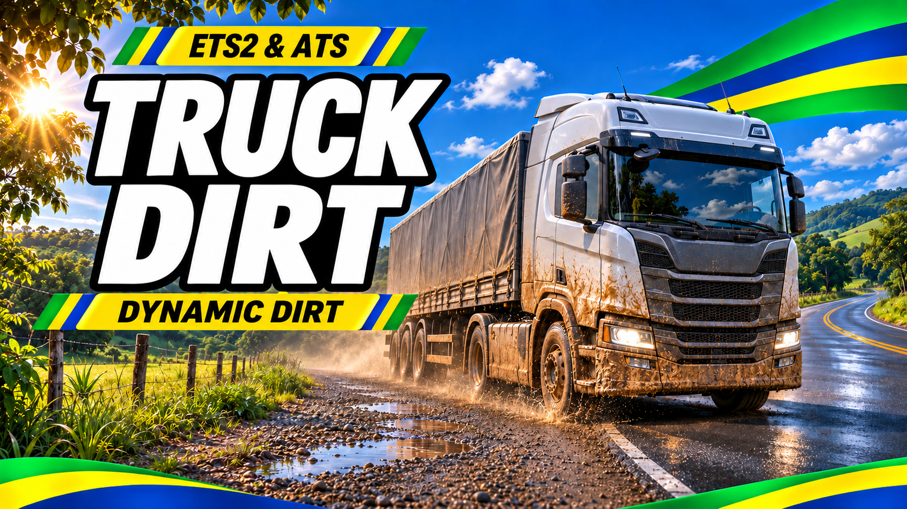
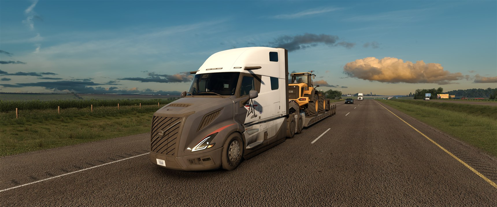
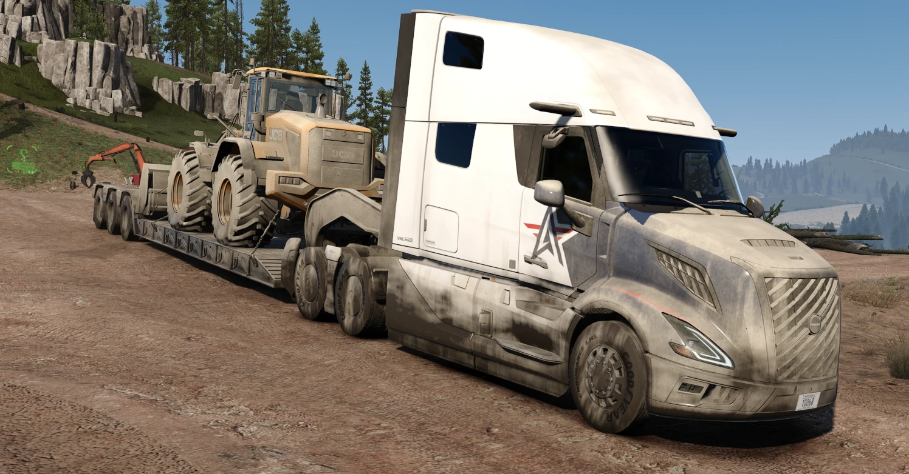
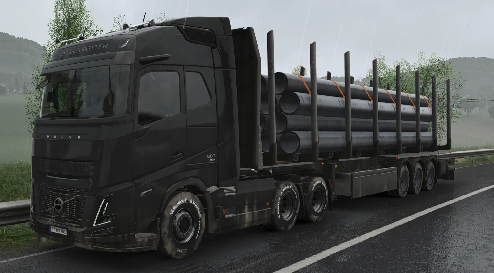
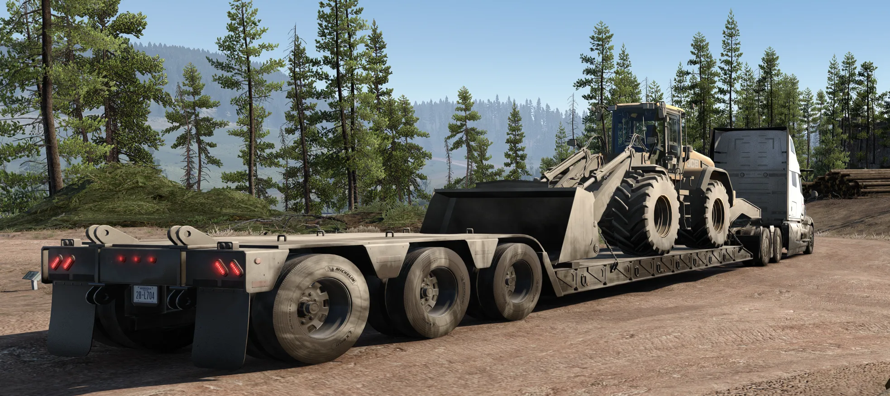
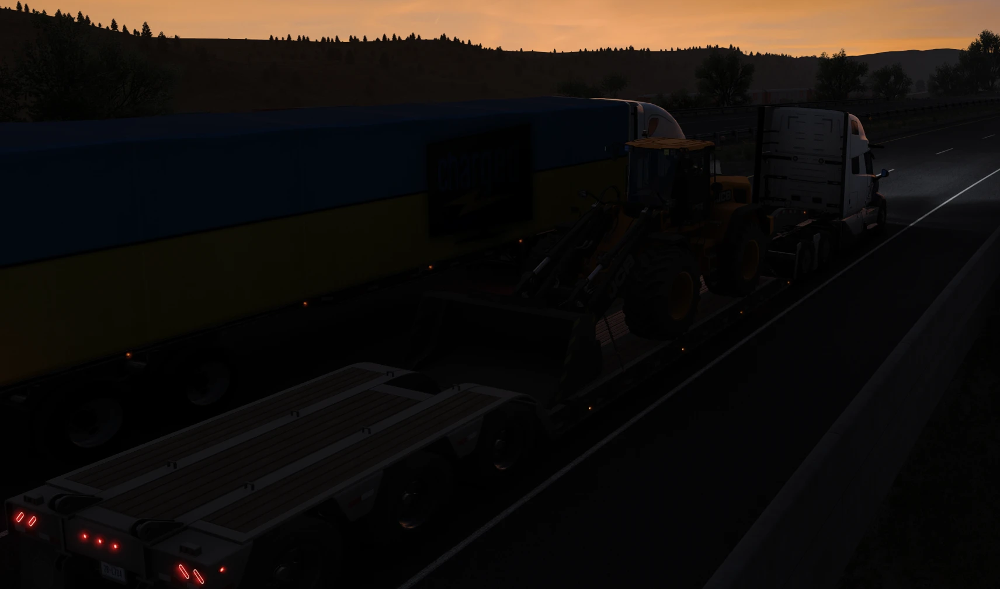
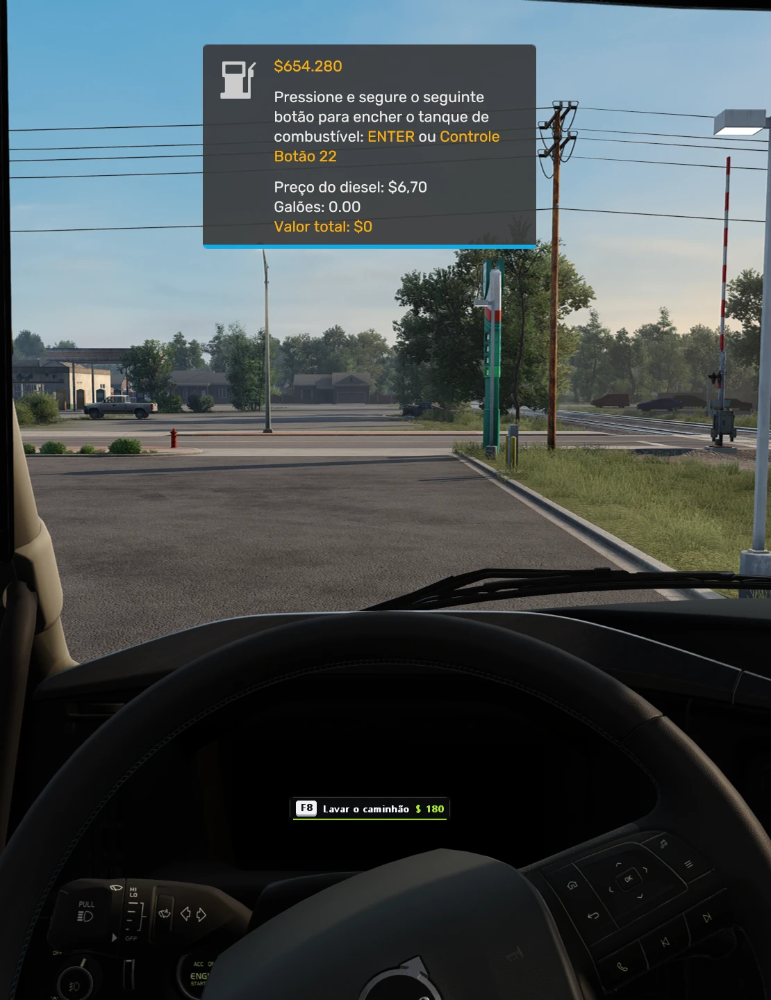
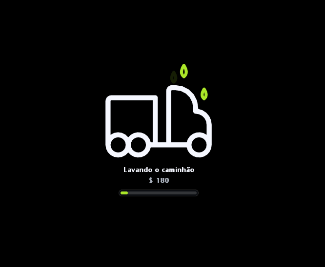
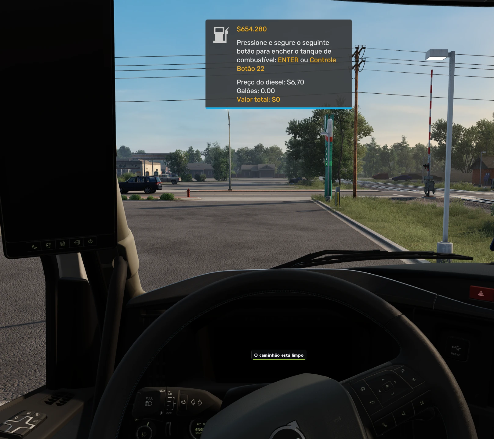
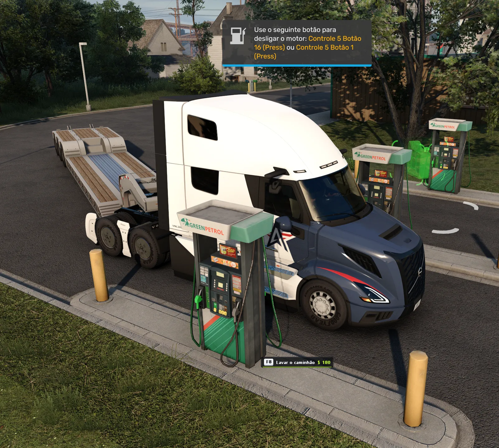

# ETS2 & ATS Truck Dirt

**English** | [Português (Brasil)](README.pt-BR.md) | [Developers](README-dev.md)

[](https://github.com/Rhaiderr/ets2-truck-dirt/releases/latest/download/ets2-truck-dirt.zip)
[](https://buymeacoffee.com/leonardoarouck)
[](#-pix-key-brazil)

**[⬇ Download the latest version (zip)](https://github.com/Rhaiderr/ets2-truck-dirt/releases/latest/download/ets2-truck-dirt.zip)** · [all versions](https://github.com/Rhaiderr/ets2-truck-dirt/releases)



*Illustrative promotional artwork, not an in-game screenshot.*

> Realism plugin (mod) for **Euro Truck Simulator 2** and **American Truck Simulator** (ETS2 / ATS): your truck, your trailers and your cargo get dirty as you drive, with dust, mud, road spray, salt and road grime, following the ground and the weather. Built on the SCS Telemetry SDK.

**Install:** copy **everything** in the zip's `plugins` folder into `<game folder>\bin\win_x64\plugins\` (ETS2 or ATS) and start the game ([details](#installation)).

> **Beta release.** Tested on ETS2 1.62 and ATS 1.62, single player, with and without the SnowyMoon graphics mod. Back up your profile if you want to be extra safe.



*ATS: the Volvo VNL's front covered in road dust and grime; the wheel loader on the lowboy was just loaded and is still clean.*

In the game, your truck leaves any dirt road looking showroom-new. With this plugin it **gets dirty little by little**, the way a real truck does: first the bumper, the wheels, the wheel arches and the side skirts; then the sides and the rear; at last a thin film even on top of the cab. A dry dirt road raises dust, rain throws mud, wet asphalt leaves a grey spray, and the miles build up that oily road grime. Rain washes it off slowly, and at a fuel station you can wash everything with one key.

## What it does

- **Dirt that follows the ground and the weather.** The game tells the plugin what each wheel is rolling on (asphalt, dirt, gravel, grass, snow). Dry dirt raises **dust**, wet ground throws **mud**, wet asphalt leaves **spray**, snow leaves **salt**, and miles of asphalt build **road grime**.
- **Gradual, and in the right places.** Dirt starts low and on the wheels and climbs from there; speed throws it higher; the trailer's front takes the truck's splash. No patches popping out of nowhere.
- **Believable tyres.** The tread takes the road's colour quickly but, always rolling, never gets as dirty as the rest (except in mud).
- **Clean new cargo.** A new load on a flatbed or a lowboy (machines, tractors, vehicles) arrives **clean**, even on a dirty trailer, and then gets dirty on its own.
- **A clean cab inside.** The dashboard and seats seen through the windows get no dust. Every stock truck of both games, all DLCs included, comes mapped.
- **Rain washes** the dirt off slowly, and the road stays wet for a while after it stops.
- **Wash at the fuel station.** Stop at a pump, pull the parking brake and press **F8**: truck and trailer come out clean. The price is charged from your in-game bank (it can be made free in the settings).
- **Saved dirt.** Your truck and your trailer stay dirty from one session to the next, and the dirt follows the game's saves.
- **Your rig only.** Traffic stays as it is. A company trailer and the quick job's vehicles start clean.
- **Road trains, doubles and dollies** get dirty too.
- **Works with mod trucks:** the plugin learns the parts of any truck or trailer while you drive.
- **42 languages**, following the game's.
- **Nothing in the game is changed:** no `.scs` file, no save. The dirt is drawn on top of the game's own image, with its light, reflections and shadows.

### In the game

<p align="center">
  
  
</p>

*Left: ATS, dirt-road dust on the bumper, the grille, the wheel arches and the skirts. Right: ETS2, wet dirt running down in the rain; the tread wiped clean by the asphalt.*

<p align="center">
  
  
</p>

<p align="center">
  
  
  
</p>

*Washing at the fuel station (ATS): stop at a pump, pull the parking brake and press **F8**; the wash screen runs and the truck comes out clean. The price comes out of your in-game bank (`charge = 0` makes it free).*

<p align="center">
  
</p>

*The rig after the wash, still at the pump: cab, chassis, wheels and lowboy clean.*

## Compatibility

| Item | Status |
|---|---|
| Games | ETS2 **1.62** and ATS **1.62** (tested versions; the tables come from the game's 1.62 models). The same DLL works in both |
| System | Windows 10/11 64-bit |
| Rendering | **DirectX 11** |
| Stock trucks and trailers | All of them, every DLC included: the cab's inside and the cargo come mapped |
| Mod trucks and trailers | Work: the plugin learns their parts while you drive. Their cab's inside uses an approximate area |
| Graphics mods | Tested with SnowyMoon (DLSS/lighting) and Weather 3.9 |
| Other plugins | Tested together with [Tire Wear](https://github.com/Rhaiderr/ets2-tire-wear) (tyre wear and blowouts) |
| TruckersMP / Convoy | The drawing turns itself off in multiplayer |
| Performance | About 1 ms a frame in the tests (RTX 4080 Super, 3440x1440): no noticeable FPS drop |

## Installation

1. Download **[ets2-truck-dirt.zip](https://github.com/Rhaiderr/ets2-truck-dirt/releases/latest/download/ets2-truck-dirt.zip)** (the latest version; older ones are under [Releases](https://github.com/Rhaiderr/ets2-truck-dirt/releases)).
2. With the game **closed**, copy **everything** in the zip's `plugins` folder into `<game folder>\bin\win_x64\plugins\`. Create the `plugins` folder if it is not there.
   - ETS2 (Steam): `C:\Program Files (x86)\Steam\steamapps\common\Euro Truck Simulator 2\bin\win_x64\plugins\`
   - ATS (Steam): `C:\Program Files (x86)\Steam\steamapps\common\American Truck Simulator\bin\win_x64\plugins\`
   - Three items: `ets2_truck_dirt.dll`, `ets2_truck_dirt.ini` and the `ets2_truck_dirt_premap` folder (the maps of the stock trucks and trailers).
   - Play both? Copy the same files into each game's `plugins` folder.
3. Start the game. The first time, the game says a plugin uses advanced SDK features: confirm with **OK** (it is the game's own message).

That's it: drive and the dirt builds up. Logs and the saved dirt live in `Documents\<game>\TruckDirt\`.

**Uninstall:** delete `ets2_truck_dirt.dll`, `ets2_truck_dirt.ini` and the `ets2_truck_dirt_premap` folder from `plugins` and, if you like, the `Documents\<game>\TruckDirt` folder. The game's files and your saves were never changed.

## Settings

The file is `ets2_truck_dirt.ini` in the `plugins` folder; every key has a comment. Edit it with the game closed.

| Section | Key | Default | What it does |
|---|---|---|---|
| `[dust]` | `rate` | `1.0` | How fast the rig gets dirty: `2.0` twice as fast, `0.5` half |
| `[dust]` | `level` | `-1` | **Test:** forces the dirt from `0.0` to `1.0`, to see the effect at once (nothing is saved); `-1` = the real dirt |
| `[wash]` | `key` | `ctrl+f7` | The wash key at the fuel station |
| `[wash]` | `price_truck`, `price_trailer` | `120`, `180` | The wash price, in euros (ETS2) or dollars (ATS) |
| `[wash]` | `charge` | `1` | `1` = charge the wash from your in-game bank; `0` = free |
| `[lang]` | `code` | `auto` | The texts' language: the game's, or a code such as `en_gb` |
| `[menu]` | `key` | `shift+f7` | The keys menu |
| `[probe]` | `tint` | `2` | `2` draws the dirt; `0` draws nothing (the dirt is still worked out and saved) |
| `[compat]` | `enforce` | `1` | After a game update, safely turns off the part of the drawing that no longer fits |

### Starting clean

The dirt lives in `Documents\<game>\TruckDirt\dirt_state.txt`, one line per truck and per trailer of yours. To start clean, delete that file with the game closed (or wash at a station).

## Known limits

- **Single player only.** In TruckersMP and Convoy the drawing turns itself off.
- **The windows stay clean** for now: dirty glass and the washer jet come in a later version.
- **Mod trucks:** for the first minutes with a new truck, while the plugin learns its parts, some parts may stay clean. Their cab's inside uses an approximate area.
- **Every trailer of a road train** has the same dirt (the first one's).
- **After a game update,** the self-check may turn the drawing off until a new version of the plugin is out; the reason is in `gpu_probe.log`.
- **Rare flickers** in the mirrors on a very fast camera turn.

## Problems and feedback

**FPS lower than usual?** Restart the game first. A long session, or the first minutes after a game update, can
sit well below what the same place gives on a fresh start: measured here on 06/11/2026, the same spot in the
cabin camera went from 46-60 FPS to 70-80 after a restart, with the plugin doing exactly the same work in both
(its own log counts the frames). The cabin camera is the heavy one in any case, because it is the only one that
draws the mirrors: with the mirrors on their highest settings the game puts out two to three times the draw calls
of the exterior camera. If a restart does not bring it back, open an issue with the log.

Open an [issue](../../issues) with:
- the game (ETS2 or ATS), the truck, the trailer and the cargo;
- the file `Documents\<game>\TruckDirt\gpu_probe.log` (it lists file paths on your PC, which may contain your Windows user name: check it before posting);
- what happened, ideally with a screenshot.

## Building

See the [developers' README](README-dev.md): requirements, how to build, the tests and the code layout.

## Explore my other mods

| [ETS2 & ATS Tire Wear](https://github.com/Rhaiderr/ets2-tire-wear) | [BR Brasil - Clima Real](https://github.com/Rhaiderr/ets2-brbrasil-climate) |
| --- | --- |
| [](https://github.com/Rhaiderr/ets2-tire-wear) | [](https://github.com/Rhaiderr/ets2-brbrasil-climate) |
| Visual tire wear and blowouts for ETS2 and ATS. | Regional summer dashboard temperatures for ETS2 + BR Brasil. |

*Illustrative cover artwork; see each project for requirements and compatibility.*

## Support my work

I make free, open-source realism plugins for Euro Truck Simulator 2 and American Truck Simulator, built and maintained in my spare time. If you enjoy them and want to support new versions and updates, you can help:

[](https://buymeacoffee.com/leonardoarouck)

<div align="center">

### 🔑 PIX key (Brazil)

</div>

```
fe1a4c11-6bb5-4844-b687-1f9143512862
```

## Licenses and credits

- This project: [MIT](LICENSE). The notices of the third-party parts built into the DLL are in [THIRD_PARTY_LICENSES.txt](THIRD_PARTY_LICENSES.txt).
- Euro Truck Simulator 2 and American Truck Simulator are trademarks of SCS Software. This project is not affiliated with SCS Software and does not distribute game files: the truck and trailer maps hold only numbers (counts and measures of the parts), made from the game's models.
