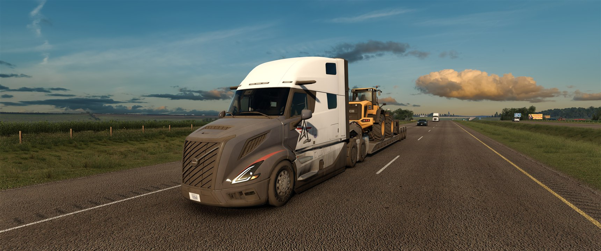
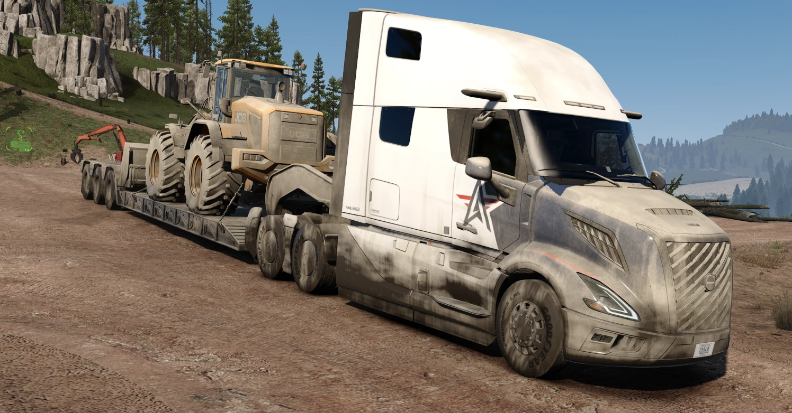
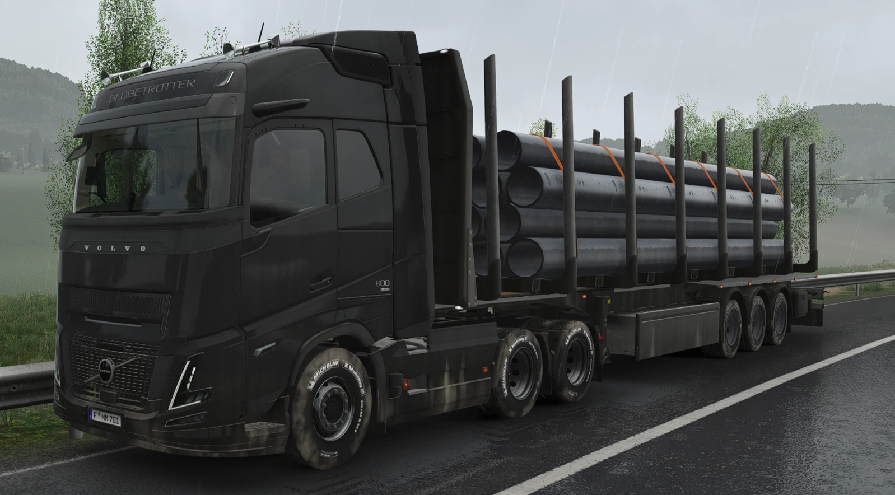
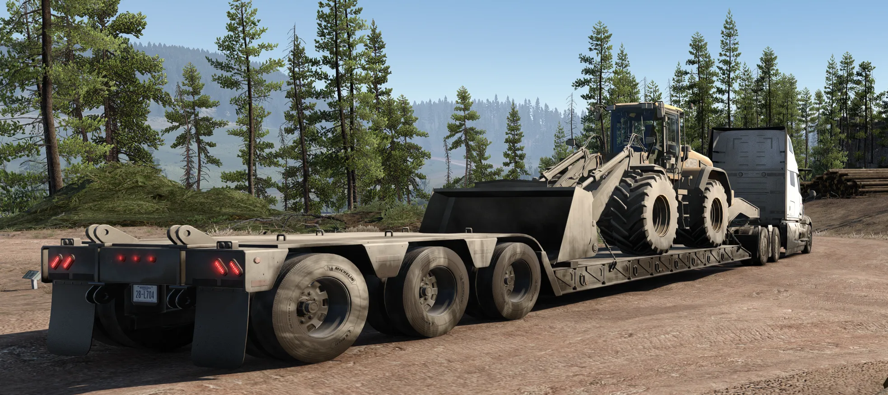
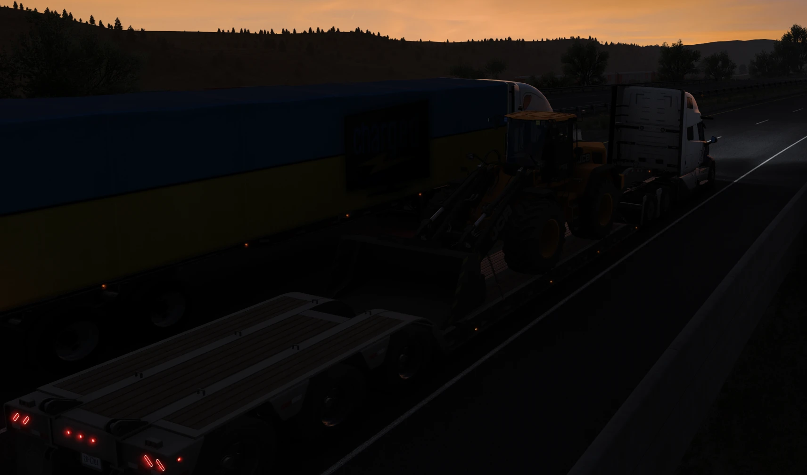
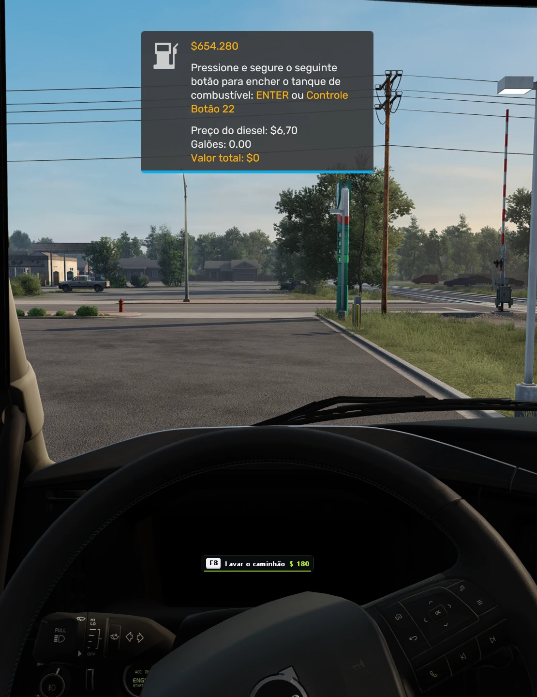
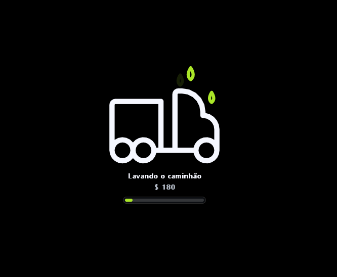
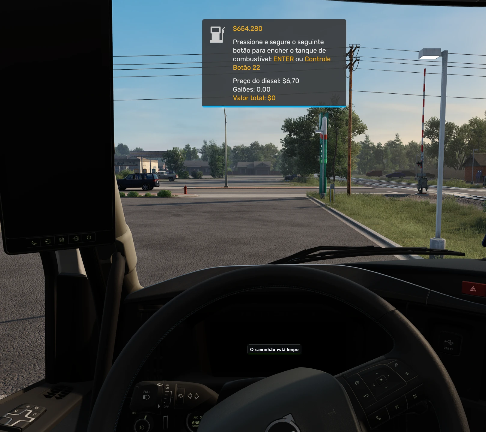
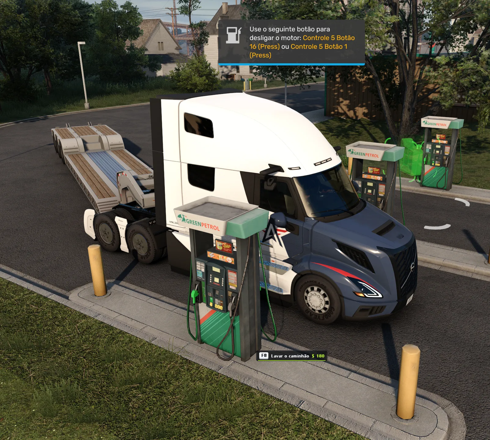

# ETS2 & ATS Truck Dirt

[English](README.md) | **Português (Brasil)** | [Desenvolvedores](README-dev.md)

> Plugin de realismo (mod) para **Euro Truck Simulator 2** e **American Truck Simulator** (ETS2 / ATS): o seu caminhão, as suas carretas e a carga ficam sujos enquanto você dirige, com poeira, lama, spray da pista, sal e fuligem de estrada, conforme o chão e o clima. Feito sobre o SCS Telemetry SDK.

[](https://github.com/Rhaiderr/ets2-truck-dirt/releases/latest/download/ets2-truck-dirt.zip)
[](https://buymeacoffee.com/leonardoarouck)
[](#-chave-pix)

**[⬇ Baixar a versão mais recente (zip)](https://github.com/Rhaiderr/ets2-truck-dirt/releases/latest/download/ets2-truck-dirt.zip)** · [todas as versões](https://github.com/Rhaiderr/ets2-truck-dirt/releases)

**Instalar:** copie **tudo** o que está na pasta `plugins` do zip para `<pasta do jogo>\bin\win_x64\plugins\` (ETS2 ou ATS) e abra o jogo ([detalhes](#instalação)).

> **Versão beta.** Testada no ETS2 1.62 e no ATS 1.62, em single player, com e sem o mod gráfico SnowyMoon. Faça backup do seu perfil se quiser segurança extra.



*ATS: a frente do Volvo VNL coberta pela poeira e pela fuligem da estrada; a pá carregadeira na prancha acabou de ser carregada e ainda está limpa.*

No jogo, o caminhão sai de qualquer estrada de terra brilhando como novo. Com o plugin, ele **vai sujando aos poucos**, do jeito que um caminhão de verdade suja: primeiro o para-choque, as rodas, as caixas de roda e as saias; depois as laterais e a traseira; por último uma película fina até no alto da cabine. Uma estrada de terra seca levanta poeira, a chuva joga lama, o asfalto molhado deixa um spray acinzentado e a estrada vai formando aquela película oleosa de fuligem. A chuva lava aos poucos, e no posto você pode lavar tudo com uma tecla.

## O que ele faz

- **Sujeira conforme o chão e o clima.** O jogo diz em que cada roda está rodando (asfalto, terra, brita, grama, neve). Terra seca levanta **poeira**, chão molhado joga **lama**, asfalto molhado deixa **spray**, neve deixa **sal**, e quilômetros de asfalto formam a **fuligem de estrada**.
- **Sujando aos poucos, no lugar certo.** A sujeira começa embaixo e nas rodas e vai subindo; a velocidade joga mais alto; a frente da carreta pega o respingo do caminhão. Nada de manchas aparecendo do nada.
- **Pneus realistas.** A banda de rodagem pega o tom da estrada logo, mas como está sempre rodando nunca fica tão suja quanto o resto (a não ser na lama).
- **Carga limpa ao ser carregada.** Uma carga nova numa prancha ou num lowboy (máquinas, tratores, veículos) chega **limpa**, mesmo com a carreta suja, e depois suja por conta própria.
- **O interior fica limpo.** O painel e os bancos vistos pela janela não pegam poeira. Todos os caminhões originais dos dois jogos, com todas as DLCs, já vêm mapeados.
- **A chuva lava** devagar, e a pista continua molhada um tempo depois que ela para.
- **Lavagem no posto.** Pare numa bomba, puxe o freio de mão e aperte **F8**: o caminhão e a carreta saem limpos. O preço é cobrado do seu banco no jogo (dá para deixar de graça na configuração).
- **A sujeira fica salva.** O seu caminhão e a sua carreta continuam sujos de uma sessão para outra, e a sujeira acompanha os saves do jogo.
- **Só nos seus veículos.** O tráfego fica como está. Uma carreta de empresa e os veículos do frete rápido começam limpos.
- **Rodotrens, bitrens e dollies** também sujam.
- **Funciona com caminhões de mod:** o plugin aprende as peças de qualquer caminhão ou carreta enquanto você dirige.
- **42 idiomas**, seguindo o idioma do jogo.
- **Nada do jogo é alterado:** nenhum `.scs` nem save. A sujeira é desenhada por cima da imagem do próprio jogo, com a luz, os reflexos e as sombras dele.

### No jogo

<p align="center">
  
  
</p>

*Esquerda: ATS, poeira de estrada de terra no para-choque, na grade, nas caixas de roda e nas saias. Direita: ETS2, sujeira molhada e escorrida na chuva; a banda de rodagem limpa pelo asfalto.*

<p align="center">
  
  
</p>

<p align="center">
  
  
  
</p>

*Lavagem no posto (ATS): pare numa bomba, puxe o freio de mão e aperte **F8**; a tela da lavagem roda e o caminhão sai limpo. O preço sai do seu banco no jogo (`charge = 0` deixa de graça).*

<p align="center">
  
</p>

*O conjunto depois da lavagem, ainda na bomba: cabine, chassi, rodas e prancha limpos.*

## Compatibilidade

| Item | Situação |
|---|---|
| Jogos | ETS2 **1.62** e ATS **1.62** (versões testadas; as tabelas vêm dos modelos do 1.62). A mesma DLL serve nos dois |
| Sistema | Windows 10/11 64 bits |
| Renderização | **DirectX 11** |
| Caminhões e carretas originais | Todos, com todas as DLCs: o interior e as cargas já vêm mapeados |
| Caminhões e carretas de mods | Funcionam: o plugin aprende as peças dirigindo. O interior visto pela janela usa uma área aproximada da cabine |
| Mods gráficos | Testado com o SnowyMoon (DLSS/iluminação) e com o Weather 3.9 |
| Outros plugins | Testado junto com o [Tire Wear](https://github.com/Rhaiderr/ets2-tire-wear) (desgaste e estouro de pneu) |
| TruckersMP / Convoy | O desenho se desliga sozinho no multiplayer |
| Desempenho | Cerca de 1 ms por quadro nos testes (RTX 4080 Super, 3440x1440): sem queda de FPS perceptível |

## Instalação

1. Baixe o **[ets2-truck-dirt.zip](https://github.com/Rhaiderr/ets2-truck-dirt/releases/latest/download/ets2-truck-dirt.zip)** (versão mais recente; as anteriores ficam em [Releases](https://github.com/Rhaiderr/ets2-truck-dirt/releases)).
2. Com o jogo **fechado**, copie **tudo** o que está na pasta `plugins` do zip para `<pasta do jogo>\bin\win_x64\plugins\`. Crie a pasta `plugins` se ela não existir.
   - ETS2 (Steam): `C:\Program Files (x86)\Steam\steamapps\common\Euro Truck Simulator 2\bin\win_x64\plugins\`
   - ATS (Steam): `C:\Program Files (x86)\Steam\steamapps\common\American Truck Simulator\bin\win_x64\plugins\`
   - São três itens: `ets2_truck_dirt.dll`, `ets2_truck_dirt.ini` e a pasta `ets2_truck_dirt_premap` (os mapas dos caminhões e carretas originais).
   - Joga os dois? Copie os mesmos arquivos para a pasta `plugins` de cada jogo.
3. Abra o jogo. Na primeira vez aparece o aviso de que um plugin usa recursos avançados do SDK: confirme com **OK** (é um aviso do próprio jogo).

Pronto: dirija e a sujeira vai aparecendo. Os logs e a sujeira salva ficam em `Documentos\<jogo>\TruckDirt\`.

**Desinstalar:** apague `ets2_truck_dirt.dll`, `ets2_truck_dirt.ini` e a pasta `ets2_truck_dirt_premap` da pasta `plugins` e, se quiser, a pasta `Documentos\<jogo>\TruckDirt`. Os arquivos do jogo e os seus saves nunca foram alterados.

## Configuração

O arquivo é o `ets2_truck_dirt.ini` da pasta `plugins`; cada chave tem um comentário. Edite com o jogo fechado.

| Seção | Chave | Padrão | Para que serve |
|---|---|---|---|
| `[dust]` | `rate` | `1.0` | A velocidade com que suja: `2.0` duas vezes mais rápido, `0.5` metade |
| `[dust]` | `level` | `-1` | **Teste:** força a sujeira de `0.0` a `1.0`, para ver o efeito na hora (nada é salvo); `-1` = a sujeira real |
| `[wash]` | `key` | `ctrl+f7` | A tecla da lavagem no posto |
| `[wash]` | `price_truck`, `price_trailer` | `120`, `180` | O preço da lavagem, em euro (ETS2) ou dólar (ATS) |
| `[wash]` | `charge` | `1` | `1` = cobra a lavagem do seu banco no jogo; `0` = de graça |
| `[lang]` | `code` | `auto` | O idioma dos textos: o do jogo, ou um código como `pt_br` |
| `[menu]` | `key` | `shift+f7` | O menu das teclas |
| `[probe]` | `tint` | `2` | `2` desenha a sujeira; `0` não desenha (a sujeira continua sendo calculada e salva) |
| `[compat]` | `enforce` | `1` | Depois de uma atualização do jogo, desliga com segurança a parte do desenho que deixou de servir |

### Começar do zero

A sujeira fica em `Documentos\<jogo>\TruckDirt\dirt_state.txt`, uma linha por caminhão e por carreta sua. Para começar limpo, apague esse arquivo com o jogo fechado (ou lave no posto).

## Limitações conhecidas

- **Só single player.** No TruckersMP e no Convoy o desenho se desliga sozinho.
- **Os vidros ficam limpos** por enquanto: vidro sujo e o jato do limpador vêm numa versão futura.
- **Caminhões de mod:** nos primeiros minutos com um caminhão novo, enquanto o plugin aprende as peças, algumas partes podem ficar sem sujeira. O interior deles usa uma área aproximada da cabine.
- **Todas as carretas de um rodotrem** têm a mesma sujeira (a da primeira).
- **Depois de uma atualização do jogo,** a autoverificação pode desligar o desenho até sair uma versão nova do plugin; o motivo fica no `gpu_probe.log`.
- **Piscadas raras** nos retrovisores numa virada muito rápida da câmera.

## Problemas e feedback

Abra uma [issue](../../issues) com:
- o jogo (ETS2 ou ATS), o caminhão, a carreta e a carga;
- o arquivo `Documentos\<jogo>\TruckDirt\gpu_probe.log` (ele lista caminhos de arquivos do seu PC, que podem conter seu nome de usuário do Windows: revise antes de postar);
- o que aconteceu, de preferência com um print.

## Compilar

Veja o [README dos desenvolvedores](README-dev.md): requisitos, como compilar, os testes e a estrutura do código.

## Apoie meu trabalho

Faço plugins de realismo gratuitos e de código aberto para Euro Truck Simulator 2 e American Truck Simulator, feitos e mantidos no meu tempo livre. Se você gosta deles e quer apoiar novas versões e atualizações, você pode ajudar:

[](https://buymeacoffee.com/leonardoarouck)

<div align="center">

### 🔑 Chave PIX

</div>

```
fe1a4c11-6bb5-4844-b687-1f9143512862
```

## Licenças e créditos

- Este projeto: [MIT](LICENSE). Os avisos das partes de terceiros embutidas na DLL estão em [THIRD_PARTY_LICENSES.txt](THIRD_PARTY_LICENSES.txt).
- Euro Truck Simulator 2 e American Truck Simulator são marcas da SCS Software. Este projeto não tem ligação com a SCS Software e não distribui arquivos do jogo: os mapas dos caminhões e carretas trazem só números (contagens e medidas das peças), gerados a partir dos modelos do jogo.
